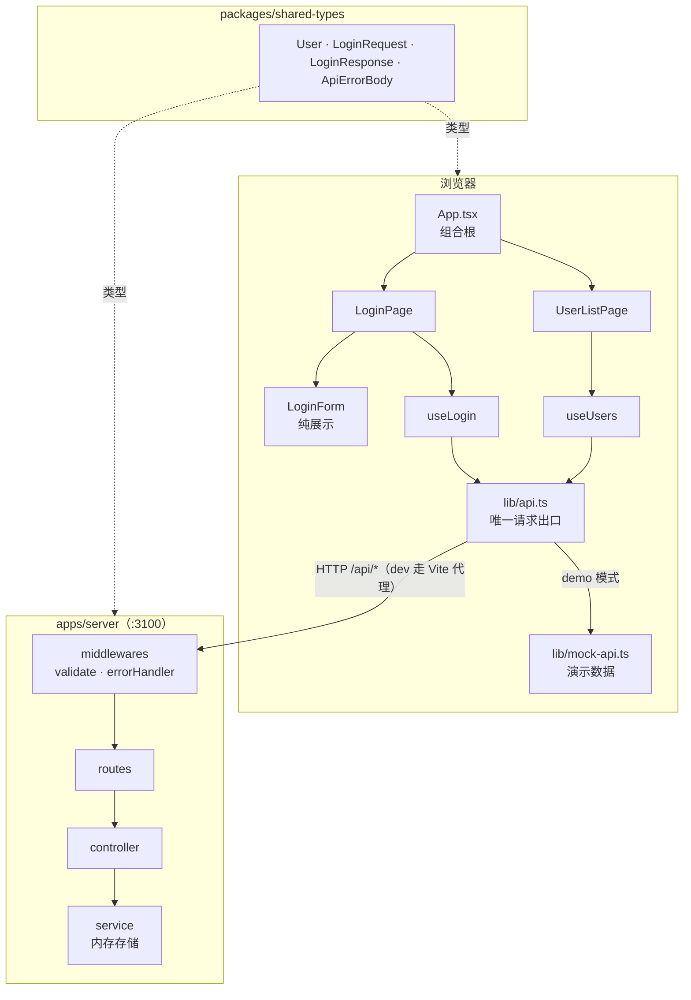
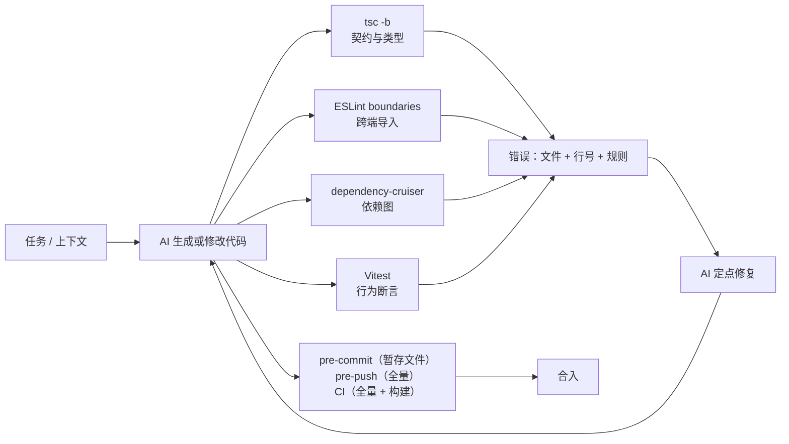

<div align="center">

# Dancang

**TypeScript Monorepo 参考实现 —— 契约层驱动的全栈骨架**

[](https://dancang.netlify.app)
[](https://github.com/C2847160/dancang/actions/workflows/ci.yml)
[](LICENSE)
[](https://www.typescriptlang.org/)
[](https://react.dev/)
[](https://nodejs.org/)
[](https://pnpm.io/)

[**Live Demo**](https://dancang.netlify.app) · [在线体验](#在线体验) · [技术栈](#技术栈) · [目录结构](#目录结构与-monorepo-架构) · [本地启动](#本地启动指南)

</div>

---

## 在线体验

> **<https://dancang.netlify.app>**

| 项目     | 值                                     |
| -------- | -------------------------------------- |
| 邮箱     | `ada@example.com`                      |
| 密码     | `password123`                          |
| 部署方式 | Netlify 静态托管（纯前端，SPA）        |
| 数据来源 | 前端内置演示数据集，**不发起网络请求** |

页面默认运行在 **demo 模式**：登录校验与用户列表都由前端本地数据提供，因此后端未部署也能完整走通「登录 → 成功态 → 退出」全流程。登录成功后表单会被替换为成功面板，可点 `Sign out` 重来。

> 想接真实后端，见 [部署](#部署) 中 `VITE_API_BASE_URL` 的配置说明。

---

## 这个项目解决什么问题

这不是又一个 TODO 应用。它把 Monorepo 中**最容易腐化的四个地方**用工具焊死，每一个都有可执行的门禁兜底：

| 典型问题                                | 本仓库的解法                                                                     |
| --------------------------------------- | -------------------------------------------------------------------------------- |
| 前后端互相 import，边界靠自觉           | ESLint `boundaries` + dependency-cruiser，两条独立链路各自 `error` 级拦截        |
| 契约类型在两侧各写一份，逐渐漂移        | `packages/shared-types` 作为唯一类型来源，`workspace:*` 引用，重命名立刻编译失败 |
| 后端分层形同虚设（controller 直接查库） | `routes → controller → service` 单向调用，无跨层快捷路径                         |
| 类型检查因 JSX/DOM 配置分家而失效       | TypeScript **Project References**（`tsc -b`）统一收口全仓                        |
| 门禁跑不起来 / 测试空转                 | 每个 workspace 都有真实可执行的 `lint / typecheck / test`                        |

---

## 技术栈

| 层         | 技术                                                  | 版本                                 | 说明                                                |
| ---------- | ----------------------------------------------------- | ------------------------------------ | --------------------------------------------------- |
| **前端**   | React                                                 | `^19.1.0`                            | 函数组件 + hooks，无状态管理库                      |
|            | Vite                                                  | `^7.0.0`                             | 开发服务器 + 生产构建，`@vitejs/plugin-react`       |
| **后端**   | Express                                               | `^5.1.0`                             | 原生 ESM，`tsx` 直接运行，无打包步骤                |
|            | zod                                                   | `^4.6.7`                             | 请求体校验与归一化，schema 与模块同目录             |
| **契约层** | `@repo/shared-types`                                  | `workspace:*`                        | 纯类型包，零运行时依赖，源码直出                    |
| **测试**   | Vitest                                                | `^5.0.5`                             | 三个 workspace 统一 runner                          |
|            | Testing Library (react / dom / user-event / jest-dom) | `^16.3` / `^10.4` / `^14.6` / `^7.0` | 组件行为测试，`jsdom@^30` 提供 DOM                  |
|            | supertest                                             | `^7.3.1`                             | 对真实中间件链发 HTTP 请求，不占端口                |
| **工程化** | TypeScript                                            | `^5.9.3`                             | `tsc -b` Project References 全图构建                |
|            | ESLint + typescript-eslint                            | `^9.18` / `^8.20`                    | Flat config，含 `eslint-plugin-boundaries`          |
|            | dependency-cruiser                                    | `^18.7.0`                            | 依赖图层面的第二道边界门禁                          |
|            | Prettier + eslint-config-prettier                     | `^3.5` / `^9.1`                      | 格式化交给 Prettier，消除与 ESLint 的规则冲突       |
|            | husky + lint-staged                                   | `^9.1` / `^15.4`                     | 提交前只检查暂存文件，推送前跑全量                  |
| **运行时** | Node.js                                               | `engines >=20`（CI/Netlify `24`）    | 全仓 ESM                                            |
|            | pnpm                                                  | `9.15.0`                             | workspace + `store-dir` 本地化，避免全局 store 争用 |

---

## 目录结构与 Monorepo 架构

```
dancang/
├── apps/
│   ├── web/                        # @repo/web — React + Vite（端口 5173）
│   │   ├── src/
│   │   │   ├── App.tsx             # 组合根：持有当前登录用户
│   │   │   ├── main.tsx            # 入口
│   │   │   ├── components/
│   │   │   │   └── LoginForm/      # 纯展示表单（不碰网络）+ 组件测试
│   │   │   ├── pages/
│   │   │   │   ├── Login/          # useLogin hook + 页面状态渲染
│   │   │   │   └── UserList/       # useUsers hook + 表格
│   │   │   ├── lib/
│   │   │   │   ├── api.ts          # 唯一请求出口（真实 / demo 模式分流）
│   │   │   │   └── mock-api.ts     # 内置演示数据
│   │   │   └── vite-env.d.ts       # import.meta.env 类型
│   │   ├── test-setup.ts           # jest-dom matchers + 显式 cleanup
│   │   ├── vite.config.ts          # dev / build：proxy /api → 3100
│   │   └── vitest.config.ts        # test：jsdom + setupFiles
│   │
│   └── server/                     # @repo/server — Express（端口 3100）
│       └── src/
│           ├── server.ts           # createApp() + 进程入口（含演示种子数据）
│           ├── middlewares/
│           │   ├── validate.ts     # zod schema → 归一化 req.body
│           │   └── error-handler.ts# AppError / notFoundHandler / errorHandler
│           └── modules/
│               ├── user/           # routes / controller / service / schema / types
│               └── auth/           # login 校验链路
│
├── packages/
│   └── shared-types/               # @repo/shared-types — 唯一契约来源
│       └── src/
│           ├── index.ts            # 统一 re-export
│           ├── user.ts             # User / CreateUserRequest / UpdateUserRequest ...
│           └── error.ts            # ApiErrorCode / ApiErrorDetail / ApiErrorBody
│
├── .github/workflows/ci.yml        # 格式 · Lint · 类型 · 测试 · 构建 · 依赖图
├── .husky/{pre-commit,pre-push}    # 本地两层门禁
├── eslint.config.mjs               # Flat config + boundaries 元素与规则
├── .dependency-cruiser.cjs         # 三条 error 级依赖规则
├── vercel.json / netlify.toml      # 前端静态部署配置
└── tsconfig.json                   # files: [] + references（全仓构建入口）
```

### 三条不可跨越的线

| 规则                                         | 由谁强制                                  |
| -------------------------------------------- | ----------------------------------------- |
| `apps/web` 不得 import `apps/server`         | `eslint-plugin-boundaries` + depcruise    |
| `apps/server` 不得 import `apps/web`         | 同上                                      |
| `shared-types` 不得依赖任何包                | 同上，且 `package.json` 无 `dependencies` |
| 跨端类型只能来自 `@repo/shared-types`        | 同上 + Project References 编译顺序        |
| 分层调用只能 `routes → controller → service` | 目录结构约定（无工具强制，见文末范围）    |

### 架构图



契约层是唯一的双向依赖源：前端与后端都只 import 它，它不 import 任何东西。

---

## AI-Assisted Development

本仓库的骨架由 AI 协同完成（Trae），而**约束 AI 的手段不是提示词，是编译器和门禁**。这一节说明为什么这套结构在 AI 参与时反而更稳。

### 问题：AI 的上下文是隔离的

用一个 AI 会话写后端、另一个会话写前端，是 AI 协作的常态。这带来三类漂移：

1. **类型漂移** —— 一侧把 `email` 改成 `mail`，另一侧不知道，运行时才炸；
2. **边界侵蚀** —— AI 为了"让功能跑起来"，会把 server 的模块直接 import 进 client，绕过 HTTP；
3. **静默绕过** —— 类型对不上时，最快的"修复"是加 `as` 或 `any`，编译通过，问题被藏起来。

### 解法：把契约变成编译边界，把边界变成错误信息

| 漂移类型     | 拦截机制                                                                                                    | 失败表现                                      |
| ------------ | ----------------------------------------------------------------------------------------------------------- | --------------------------------------------- |
| 类型漂移     | 所有跨端类型只存在于 `shared-types`；两侧用 `workspace:*` 消费；`tsc -b` 按 references 先构建契约再构建应用 | 改名后**两个应用同时**编译失败，并精确指到行  |
| 边界侵蚀     | `eslint-plugin-boundaries`（元素 + 允许矩阵）+ depcruise（依赖图）                                          | 违规 import 直接 `error`，消息里带规则 ID     |
| 静默绕过     | `@typescript-eslint/no-explicit-any: error`；契约包零依赖，没有运行时逃生舱                                 | 想用 `any` 堵住类型错误时，门禁先红           |
| 错误格式分裂 | 统一错误信封 `ApiErrorBody`（`code` / `message` / `details`），服务端中间件唯一产出点                       | 客户端只需实现一种解析；AI 不需要猜第二种约定 |

### 反馈闭环

AI 不需要"记住"规则，它只需要能读懂失败信号。三处门禁的输出都是文件路径 + 行号 + 规则名：



### 这套结构**没有**解决的问题

保持诚实比显得完整更重要：

- **类型正确 ≠ 语义正确**。契约能保证两侧字段名与形状一致，保证不了这个设计是对的；
- **测试仍然很薄**（22 例）。AI 可以写出类型完美、但行为错误的实现，现有门禁不拦；
- **分层规则只靠目录约定**。`routes → controller → service` 没有工具强制，AI 可能跨层调用；
- **重复代码不拦**。同一个格式化函数在两侧各写一遍，类型检查完全通过。

换句话说：**契约层消灭的是"不一致"，不是"错误设计"。**

---

## 功能与 API

| 能力                   | 位置                                                                                         | 说明                                                                                                                        |
| ---------------------- | -------------------------------------------------------------------------------------------- | --------------------------------------------------------------------------------------------------------------------------- |
| 契约层（单一类型来源） | [packages/shared-types](packages/shared-types)                                               | `User` / `CreateUserRequest` / `UpdateUserRequest` / `UserListResponse` / `LoginRequest` / `LoginResponse` / `ApiErrorBody` |
| 请求体校验             | [apps/server/src/middlewares/validate.ts](apps/server/src/middlewares/validate.ts)           | zod schema 在进入 controller 前校验并归一化 `req.body`，失败统一转 400 + 字段级 details                                     |
| 全局错误处理           | [apps/server/src/middlewares/error-handler.ts](apps/server/src/middlewares/error-handler.ts) | 4 参 Express 错误中间件：`AppError` → 对应状态码，`ZodError` → 400，未知异常 → 500 且只回固定文案                           |
| 依赖方向门禁           | [eslint.config.mjs](eslint.config.mjs)                                                       | `web-app` / `server-app` 只能依赖 `shared-types`；`shared-types` 不允许依赖任何包                                           |
| 依赖图门禁             | [.dependency-cruiser.cjs](.dependency-cruiser.cjs)                                           | 三条 error 级规则：禁止 web→server、server→web、shared-types 引入包外模块                                                   |
| 全仓类型检查           | [tsconfig.json](tsconfig.json)                                                               | `files: []` + `references` → `tsc -b` 按项目引用构建，各 app 用各自的 `jsx` / `lib` 配置                                    |
| 后端分层示例           | [apps/server/src/modules](apps/server/src/modules)                                           | 垂直模块：`user`（routes / controller / service / schema）与 `auth`（login 校验链路）                                       |
| 前端页面示例           | [apps/web/src/App.tsx](apps/web/src/App.tsx)                                                 | 组合根：登录区（含 loading / 成功 / 失败提示）+ 用户列表区                                                                  |
| 部署配置               | [netlify.toml](netlify.toml) / [vercel.json](vercel.json)                                    | 前端静态部署：pnpm workspace 安装、Vite 构建、SPA rewrite；无后端时自动使用演示数据                                         |
| 测试                   | `apps/*/src/**/*.test.{ts,tsx}`                                                              | server 19 例（service 单测 9 + supertest 集成 10）；web 2 例组件测试；shared-types 1 例                                     |

### 已实现的 API

| 方法     | 路径              | 说明                                                             |
| -------- | ----------------- | ---------------------------------------------------------------- |
| `GET`    | `/api/users`      | 返回全部用户（`items` + `total`，无分页参数）                    |
| `GET`    | `/api/users/:id`  | 按 id 查询，不存在返回 `404` + JSON 错误体                       |
| `POST`   | `/api/users`      | 创建用户，`email` / `name` / `password`(≥8) 必填，不校验邮箱重复 |
| `PATCH`  | `/api/users/:id`  | 局部更新，不存在返回 `404`                                       |
| `DELETE` | `/api/users/:id`  | 删除，不存在返回 `404`                                           |
| `POST`   | `/api/auth/login` | 校验邮箱与密码，成功返回 `LoginResponse`，失败返回 `401`         |

所有错误响应共用一种信封：

```json
{
  "error": {
    "code": "VALIDATION_ERROR",
    "message": "Request body is invalid",
    "details": [{ "path": "password", "message": "Password must be at least 8 characters" }]
  }
}
```

`code` 取值：`VALIDATION_ERROR` / `UNAUTHORIZED` / `NOT_FOUND` / `CONFLICT` / `INTERNAL_ERROR`。

### 输入输出示例

```bash
# 列表
curl http://localhost:3100/api/users

# 创建（注意 password 至少 8 位）
curl -X POST http://localhost:3100/api/users \
  -H 'Content-Type: application/json' \
  -d '{"email":"new@example.com","name":"New User","password":"password123"}'

# 登录
curl -X POST http://localhost:3100/api/auth/login \
  -H 'Content-Type: application/json' \
  -d '{"email":"ada@example.com","password":"password123"}'
```

---

## 本地启动指南

### 1. 前置要求

| 工具 | 版本                                              | 检查命令        |
| ---- | ------------------------------------------------- | --------------- |
| Node | 推荐 24（`engines` 要求 ≥20）                     | `node -v`       |
| pnpm | 9.15.0（Corepack 会按 `packageManager` 自动切换） | `pnpm -v`       |
| Git  | 任意                                              | `git --version` |

`engines` 只强制 `>=20`，但 CI 与 Netlify 都跑 Node 24，本地对齐到 24 可避免行为差异。

### 2. 四步跑通

```bash
git clone https://github.com/C2847160/dancang.git
cd dancang
pnpm install          # 自动执行 prepare → 安装 husky 钩子
pnpm dev              # 并行启动 web + server
```

| 服务     | 地址                                    |
| -------- | --------------------------------------- |
| 前端     | <http://localhost:5173>                 |
| 后端     | <http://localhost:3100>                 |
| API 代理 | 前端 `/api/*` → `http://localhost:3100` |

本地模式打的是**真实后端**。`apps/server/src/server.ts` 的进程入口会预置演示账号 `ada@example.com` / `password123`（仅实际启动进程时执行，`createApp()` 与测试不受影响）。

### 3. 关于 `.npmrc`

项目把 pnpm store 放在仓库内的 `.pnpm-store/`，而不是全局目录。这样多个项目并发安装时不会争抢同一个全局 store（Windows 上常见 `ERR_PNPM_EPERM`）。该目录已在 `.gitignore` 中排除。

### 4. 环境变量

见 [.env.example](.env.example)。两个变量：

| 变量                | 默认   | 作用                                               |
| ------------------- | ------ | -------------------------------------------------- |
| `PORT`              | `3100` | 后端端口；改动后需同步 `vite.config.ts` 的代理目标 |
| `VITE_API_BASE_URL` | 空     | 前端 API 基址。空值在本地走代理，生产走 demo 模式  |

注入方式因 shell 而异：

```bash
# bash / zsh
PORT=3200 pnpm --filter @repo/server dev
```

```powershell
# PowerShell
$env:PORT=3200; pnpm --filter @repo/server dev
```

### 5. 常用命令

| 命令                | 作用                                 | 说明                                                                         |
| ------------------- | ------------------------------------ | ---------------------------------------------------------------------------- |
| `pnpm dev`          | 并行启动 web + server                | 前端 5173，后端 3100                                                         |
| `pnpm lint`         | ESLint（含 boundaries 依赖方向规则） | 3 个 workspace 全量检查                                                      |
| `pnpm typecheck`    | `tsc -b`（Project References 全图）  | 覆盖 shared-types → server → web                                             |
| `pnpm test`         | `vitest run`                         | shared-types 1 例；server 19 例；web 2 例                                    |
| `pnpm check:deps`   | `depcruise apps packages`            | 依赖图层面校验三条边界规则                                                   |
| `pnpm format:check` | `prettier --check .`                 | 校验格式化，CI 会跑                                                          |
| `pnpm format`       | `prettier --write .`                 | 本地批量修复格式化                                                           |
| `pnpm build`        | `pnpm -r run build`                  | 目前**仅** `apps/web` 有 build 脚本；server 以 `tsx` 直接运行，无 build 步骤 |

### 6. 三层门禁的执行时机

| 时机                | 钩子 / 平台         | 实际执行内容                                                            |
| ------------------- | ------------------- | ----------------------------------------------------------------------- |
| `git commit`        | `.husky/pre-commit` | `lint-staged`：暂存文件跑 `eslint --fix` + `prettier --write`           |
| `git push`          | `.husky/pre-push`   | `typecheck` + `test` + `check:deps`                                     |
| PR / push 到 `main` | GitHub Actions `CI` | `format:check` + `lint` + `typecheck` + `test` + `build` + `check:deps` |

提交前检查只覆盖被修改的文件（毫秒级），推送前与 CI 跑全量（秒级）。任何一层不通过都会中断流程。

### 7. 常见问题排查

| 现象                                                    | 原因与处理                                                                                                                               |
| ------------------------------------------------------- | ---------------------------------------------------------------------------------------------------------------------------------------- |
| `EADDRINUSE :3100`                                      | 端口被占用。`netstat -ano \| findstr :3100` 找 PID，或用 `$env:PORT=3200; pnpm --filter @repo/server dev` 换端口（记得同步改 Vite 代理） |
| 前端请求 `/api/*` 返回 502 / 连接被拒绝                 | 后端没起来，或端口与 [vite.config.ts](apps/web/vite.config.ts) 的代理目标不一致                                                          |
| `ERR_PNPM_EPERM`                                        | 全局 store 被其他进程占用。确认 [.npmrc](.npmrc) 的 `store-dir=.pnpm-store` 生效，必要时删除 `.pnpm-store/` 重装                         |
| `husky` 提示钩子未安装                                  | 手动执行 `pnpm exec husky init`，或重新 `pnpm install` 触发 `prepare`                                                                    |
| PowerShell 执行 `pnpm install` 报 `PSSecurityException` | 执行策略阻止了 `.ps1`。改用 `pnpm.cmd install`，不要为此关闭执行策略                                                                     |
| `tsx: not found`                                        | 依赖未安装完整，重新 `pnpm install`                                                                                                      |

### 8. 页面行为

打开 <http://localhost:5173> 后看到登录区与用户列表区：

| 状态     | 表现                                                                  |
| -------- | --------------------------------------------------------------------- |
| 加载中   | `Loading…` / `Checking credentials…`                                  |
| 请求失败 | 错误文案取后端 `error.message` 原文（如 `Invalid email or password`） |
| 无数据   | 表格正文显示 `No users`                                               |
| 登录成功 | 表单替换为 `Signed in as ...` + `Sign out`                            |

---

## 部署

前端是纯静态 SPA，两种配置都已随仓库提供：`netlify.toml`（当前线上方案）与 `vercel.json`（备选）。

### 模式矩阵

| 场景             | `VITE_API_BASE_URL` | 行为                                                      |
| ---------------- | ------------------- | --------------------------------------------------------- |
| 本地开发         | 留空                | 走 Vite 代理 → 真实后端                                   |
| 线上演示（默认） | 留空                | 纯前端演示数据，**零网络请求**，页头显示 `demo data` 角标 |
| 线上接真实后端   | 填后端地址          | 真实 HTTP，错误按 `ApiErrorBody` 原文展示                 |

> 这里没有做"连不上就返回 Mock"的运行时兜底：静态托管会把 `/api/*` 回退成 `index.html` 并返回 **200**，运行时无法区分"接口返回了 HTML"和"接口正常"，兜底会被骗过。因此模式在构建时决定。

### Netlify（当前部署）

配置见 [netlify.toml](netlify.toml)：构建 `pnpm --filter @repo/web build`，产物 `apps/web/dist`，`NODE_VERSION=24`，`HUSKY=0`（构建机不装 git 钩子）。pnpm 版本由根 `package.json` 的 `packageManager` 经 Corepack 决定，Netlify **没有** `PNPM_VERSION` 变量。

1. 打开 <https://app.netlify.com/start>，用 GitHub 登录；
2. **Import an existing project** → **GitHub** → 选 `C2847160/dancang`；
3. 构建设置**全部留空**，`netlify.toml` 已定义；Base directory 保持仓库根，**不要**填 `apps/web`；
4. 点 **Deploy site**；
5. **Site configuration → General → Change site name** 可改成 `dancang`，得到 `https://dancang.netlify.app`。

### Vercel（备选）

[vercel.json](vercel.json) 位于仓库根：`framework: vite`、`installCommand: pnpm install --frozen-lockfile`、`buildCommand: pnpm --filter @repo/web build`、`outputDirectory: apps/web/dist`，并带 SPA rewrite。三个字段必须写死，自动探测会把 workspace 的输出目录猜错。

### 常见坑

| 现象                                      | 原因 / 处理                                                                                                       |
| ----------------------------------------- | ----------------------------------------------------------------------------------------------------------------- |
| 构建报 `ERR_PNPM_WORKSPACE_PKG_NOT_FOUND` | Base / Root Directory 被设成了 `apps/web`，改回仓库根                                                             |
| 页面 404 / 白屏                           | 配置文件没在仓库根，或 `publish` / `outputDirectory` 写错                                                         |
| 页面完全打不开、连错误码都没有            | 本地 DNS 污染（`*.vercel.app` 整区在部分网络被劫持）。换 Netlify、绑自定义域名，或换网络                          |
| 登录一直报 `Cannot reach the API at ...`  | `VITE_API_BASE_URL` 填成了静态站点自己的域名：静态站点没有 `/api`，会被 rewrite 回 `index.html`。必须指向真实后端 |
| 改了环境变量但页面没变                    | 没有重新部署。Vite 在**构建时**内联 `VITE_*`，必须 redeploy                                                       |
| 部署后登录成功但刷新丢状态                | 登录态只存在 React state 里，不写 localStorage，也不签发 token（见下文范围）                                      |

---

## 当前范围（未实现的部分）

为避免误解，以下内容**尚未实现**，仅在规范中预留：

- 数据库 / 持久化（当前为内存存储，重启即清空；Netlify 部署使用前端演示数据）；
- 数据库层与 repository 抽象；
- 鉴权会话（登录成功不签发 token / cookie，刷新即丢失登录态）；
- 分页、排序、搜索等列表能力；
- 邮箱唯一性约束（`CONFLICT` 错误码已在 `shared-types` 中定义，服务端尚未抛出）；
- 后端部署与 CI/CD（当前仅前端静态托管）；
- 单元测试之外的端到端测试（Playwright 等）；
- `routes → controller → service` 分层调用目前只靠目录约定，没有工具强制；
- 依赖安全审计（`pnpm audit`）与依赖更新（Renovate / Dependabot）。

---

## License

[MIT](LICENSE) © 2026 chen
